 

*Aspiring Data Analyst ♡ A curious mind with a love for data & little details*

---

## 🌸 ♡ A LITTLE ABOUT ME

Hey there! I'm **Anjali S. Kshirsagar** — an aspiring Data Analyst who loves discovering little stories hidden inside data. Just like my tiny desk companion, I'm curious, a little creative, and always learning something new. ☕

- **My interests:** Data cleaning, exploratory analysis, SQL queries and beautiful dashboards
- **Learning corner:** Python, Pandas, SQL, Excel and Power BI
- **My process:** Ask → Explore → Analyse → Find insights → Share
- **Little dream:** Become a thoughtful analyst who turns numbers into meaningful decisions

## 🧸 ✿ MY LITTLE TOOLKIT

  

## 🍓 ♡ DATA STORIES & PROJECTS

### 🛍️ 01 · E-commerce Sales Analysis
[**Open repository ↗**](https://github.com/Anjali-xa/E-commerce-Sales-Analysis)

Explore online-store performance through orders, revenue, products and regions.

- **Analysis:** Monthly revenue trends, order volume, category mix and regional comparisons
- **Key question:** Which products and regions contribute most to sales?
- **Tools:** Python · Pandas · SQL · Matplotlib

### 📦 02 · Amazon Sales Analysis
[**Open repository ↗**](https://github.com/Anjali-xa/Amazon-Sales-Analysis)

Explore e-commerce order patterns, product categories and fulfilment performance.

- **Analysis:** Category performance, order status and monthly sales patterns
- **Key question:** How do order status and product categories shape sales?
- **Tools:** Python · Pandas · SQL · Matplotlib

### 🎬 03 · Netflix Content Analysis
[**Open repository ↗**](https://github.com/Anjali-xa/Netflix-Content-Analysis)

Explore catalogue composition and content trends across movies and television.

- **Analysis:** Movies vs. TV shows, country distribution and release-year patterns
- **Key question:** How has the catalogue composition changed over time?
- **Tools:** Python · Pandas · SQL · Matplotlib

### 👩‍💼 04 · HR Analytics
[**Open repository ↗**](https://github.com/Anjali-xa/-HR-Analytics)

Explore workforce data to understand employee attrition and department-level patterns.

- **Analysis:** Attrition rate, employee profiles and department comparisons
- **Key question:** How does attrition vary by department and employee segment?
- **Tools:** Python · Pandas · SQL · Power BI

### 🦠 05 · COVID-19 Trends Analysis
[**Open repository ↗**](https://github.com/Anjali-xa/COVID-19-Trends-Analysis)

Explore reported case trends and country-level differences over time.

- **Analysis:** Time trends, country comparisons and reported-count ratios
- **Key question:** How did reported cases change across dates and locations?
- **Tools:** Python · Pandas · SQL · Matplotlib

### 💌 06 · Customer Churn Analysis
[**Open repository ↗**](https://github.com/Anjali-xa/Customer-Churn-Analysis)

Explore customer attributes and patterns associated with churn.

- **Analysis:** Churn rate, tenure patterns and customer-segment comparisons
- **Key question:** Which customer groups show different churn patterns?
- **Tools:** Python · Pandas · SQL · Matplotlib

### 🍽️ 07 · Zomato Restaurant Analysis
[**Open repository ↗**](https://github.com/Anjali-xa/Zomato-Restaurant-Analysis)

Explore restaurant listings through cuisine, ratings, location and cost.

- **Analysis:** Cuisine distribution, rating patterns and average-cost comparisons
- **Key question:** How do cuisine, location and cost vary across listings?
- **Tools:** Python · Pandas · SQL · Matplotlib

### 💰 08 · Financial Performance Analysis
[**Open repository ↗**](https://github.com/Anjali-xa/Financial-Performance-Analysis)

Explore revenue, expenses, profit and budget comparisons.

- **Analysis:** Profit, margin, monthly trends and business-unit comparisons
- **Key question:** How does actual performance compare with budget?
- **Tools:** Python · Pandas · SQL · Excel

### 🛒 09 · Superstore Sales Analysis
[**Open repository ↗**](https://github.com/Anjali-xa/Superstore-Sales-Analysis)

Explore retail sales and profitability across products, categories and regions.

- **Analysis:** Sales trends, category profitability and regional comparisons
- **Key question:** Which segments drive sales and profit?
- **Tools:** Python · Pandas · SQL · Power BI

Project status: These are learning projects in progress. Current CSVs are synthetic demo data, not verified real-world findings. Dataset validation and final visual outputs are still in progress.

---

## 🌷 ✧ MY GITHUB CORNER

  

## 💌 ♡ LET'S CONNECT

  

*Thanks for visiting my portfolio. More questions, more learning, better insights.*

**MAKE · LEARN · GROW ♡**

